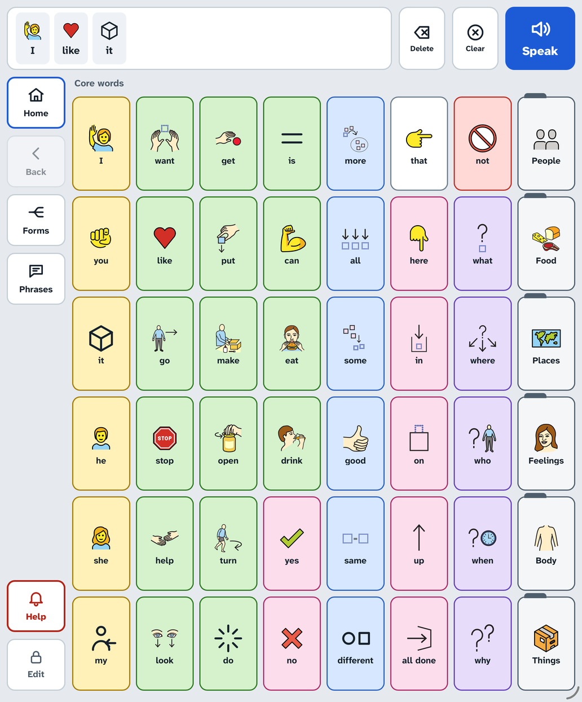
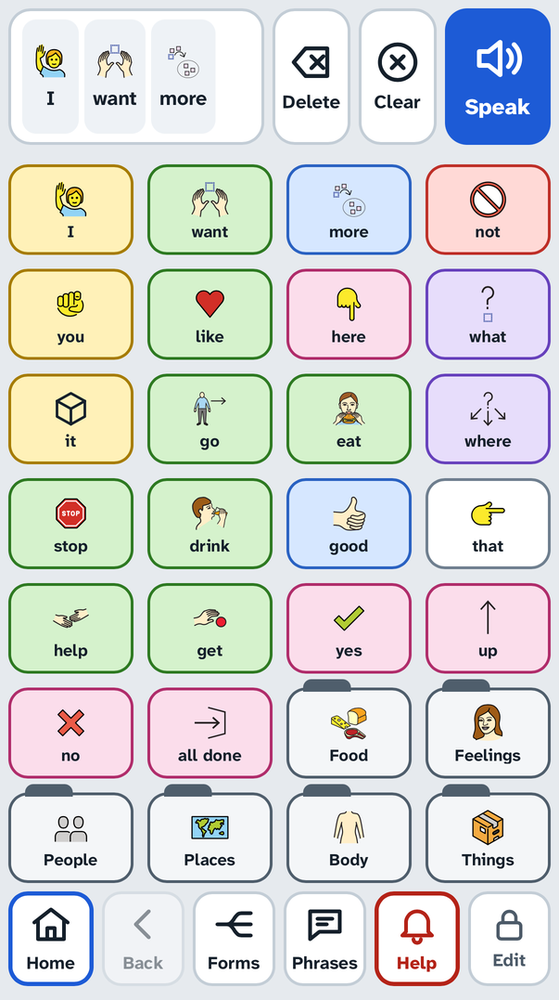
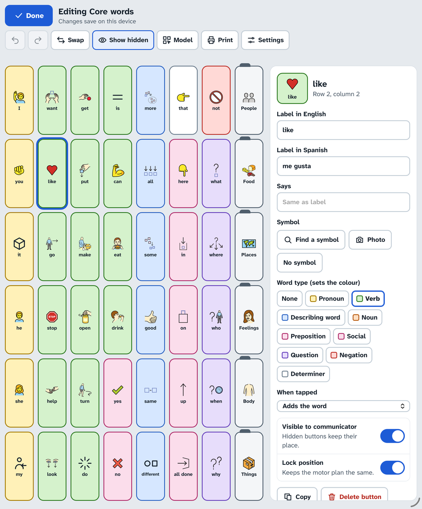
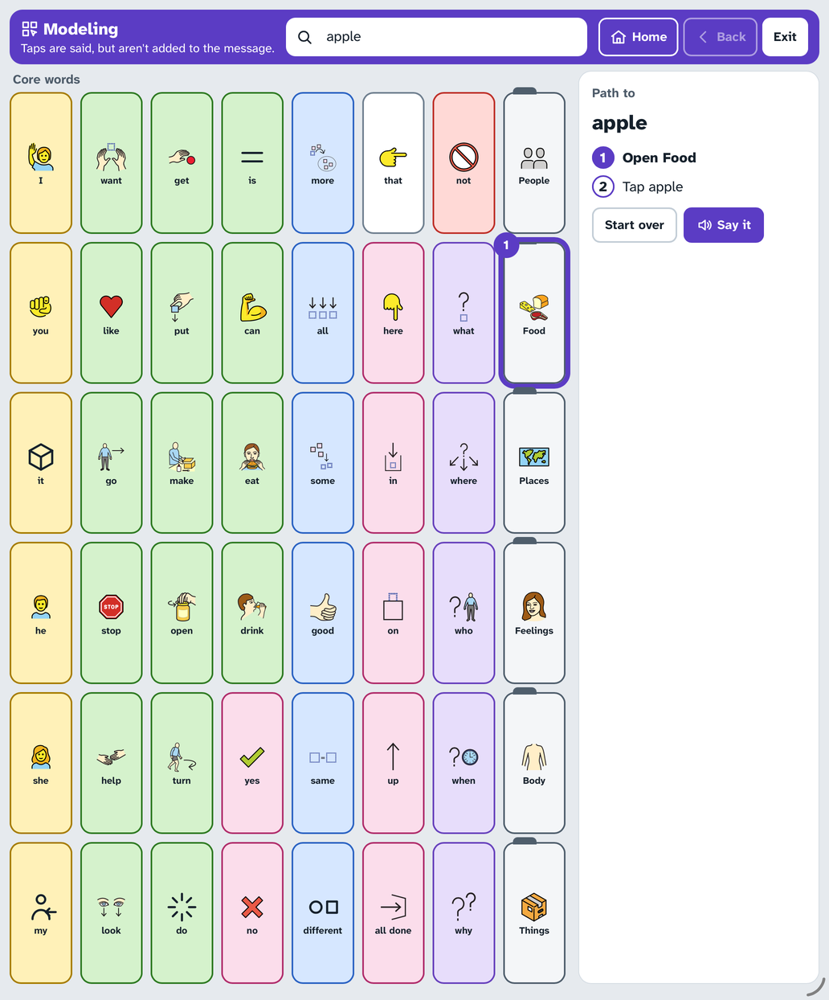
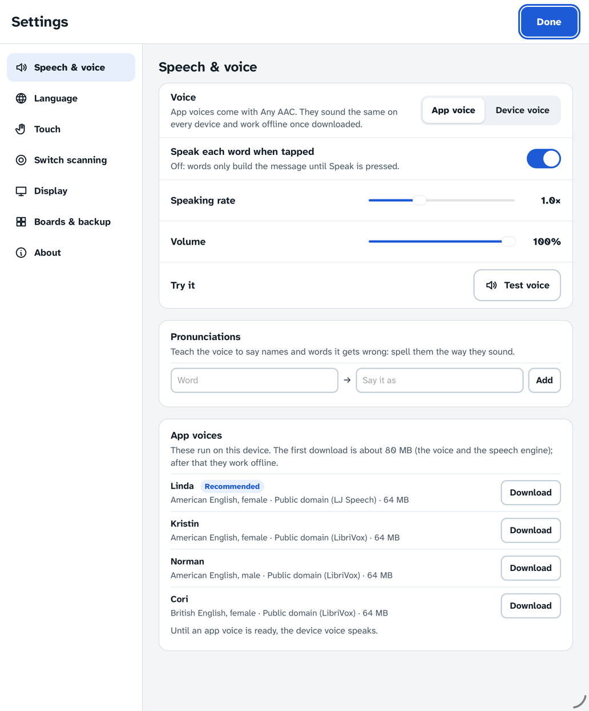
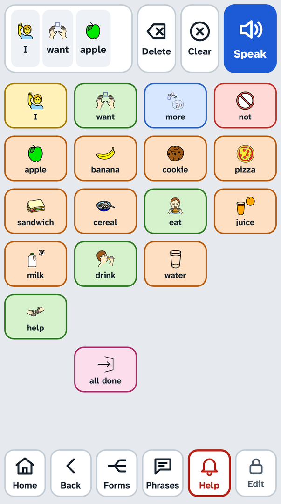

# Any AAC

A free, open-source AAC (augmentative and alternative communication) app. It runs in the browser on iPad, iPhone, Android, Chromebook, Windows and Mac, keeps working with no internet connection once installed, and can be self-hosted from a folder of static files.

**Try it: [any-aac.com](https://any-aac.com/).** On an iPad or iPhone, open it in Safari and tap Share → **Add to Home Screen**. On Android, use Chrome's ⋮ menu → **Install app**. [Setting up a device](docs/setup.md) covers the rest.

<p align="center">
  
  
</p>

## Built on research

Any AAC's design follows published AAC research. The [research notes](docs/research/README.md) record each source and the decision it led to.

- **Core vocabulary.** The English home board holds Project Core's [Universal Core](https://www.med.unc.edu/ahs/clds/universal-core-vocabulary/), 36 words chosen from published core vocabulary lists, device vocabularies and word-frequency data, plus six early words from research on toddlers' core vocabulary. Topic boards add the people, things and places beginning communicators talk about most ([vocabulary findings](docs/research/findings/vocabulary.md)).
- **Spanish chosen in Spanish.** The Spanish-first boards follow Soto and Cooper's [early Spanish vocabulary for AAC](https://doi.org/10.1080/07434618.2021.1881822): words young Spanish speakers actually use, with verbs in the forms they use them, rather than a translation of an English board ([decision 0004](docs/research/decisions/0004-spanish-first-vocabulary.md)).
- **Words that never move.** Each word keeps one place, so finding it becomes automatic (motor planning). Vocabulary grows by revealing words, not rearranging them; core words keep their place on every topic board, and phone layouts keep the tablet's order ([decision 0005](docs/research/decisions/0005-phone-layouts.md)). The starter boards come in three sizes (24, 48 and 84 places), and each word stays in the same part of the screen in all of them ([decision 0015](docs/research/decisions/0015-three-sizes.md)).
- **Colour and order.** Word types are colour-coded (Modified Fitzgerald Key) and run left to right in sentence order, which research on colour cues shows speeds up finding symbols.
- **Teaching.** Modeling mode and Find a word support aided language modeling, the best-evidenced way to teach AAC ([teaching findings](docs/research/findings/teaching.md)).
- **A plain, consistent interface.** It follows the W3C's guidance on cognitive accessibility, and every screen is checked against WCAG 2.2 AA in the automated tests ([interface findings](docs/research/findings/interface.md)).
- **Speech that's always there.** Voices that run on the device, so speaking never depends on a connection, with every word's audio prepared ahead; only voices whose licences are clearly open ([decisions 0001](docs/research/decisions/0001-offline-voice.md) and [0002](docs/research/decisions/0002-only-clearly-licensed-voices.md)).

## What it does

- **Speaks from a word board.** Core words stay in the same place on every board, coloured by word type, with topic folders (People, Food, Places, Feelings, Body, Things) and quick phrases. Phones get their own smaller layout with the words in the same order.
- **Works offline.** Once installed, everything works with no connection: boards, symbols and speech.
- **Voices that work offline.** Any AAC speaks with app voices (Piper, running on the device): they sound the same everywhere, play each word in about 20–45 ms, and keep speaking when an iPhone or iPad is in silent mode. Every starter word is bundled as audio, so it speaks from the first tap, while the full voice downloads in the background. We only offer voices whose licences are clearly open, and the device's own voice is there too.
- **English and Spanish.** Two starter vocabularies: English-first with Spanish translations, and Spanish-first, with words chosen in Spanish. Bilingual communicators switch languages with one tap, and the app's own menus come in both.
- **Word forms.** A Forms button changes the last word to another form: want → wanted, cansado → cansada.
- **Editing in place**, behind a press-and-hold on Edit: words, symbols (the whole Mulberry library, or a photo), colours, hidden words, locked positions, new boards, undo.
- **Modeling.** Partners can tap words on the communicator's own board without adding them to the message, and **Find a word** shows the steps to any word.
- **Switch scanning** with one or two switches (keys, game controllers, touch or mouse), including auditory scanning.
- **Readable and adjustable.** Light, Dark and High contrast themes, label size and position, button spacing for keyguards, text-only boards. The interface is checked against WCAG 2.2 AA, with 44 px minimum targets.
- **Your data stays yours.** Boards use the [Open Board Format](https://www.openboardformat.org/), so they move to and from other AAC apps. One-file backups hold every board, picture and setting.

<table>
  <tr>
    <td></td>
    <td></td>
  </tr>
  <tr>
    <td align="center">Editing a word in place</td>
    <td align="center">Modeling, with Find a word</td>
  </tr>
  <tr>
    <td></td>
    <td align="center"></td>
  </tr>
  <tr>
    <td align="center">Voices, with their licences</td>
    <td align="center">A topic board keeps core words in place</td>
  </tr>
</table>

## Privacy

Any AAC collects nothing: no accounts, no analytics, no third-party scripts. Boards, settings and voices are stored in the browser on the device. The hosted app makes no requests to anyone else: voice files come from the same site, and a security policy makes the browser refuse anything from elsewhere. The voice for the language in use downloads the first time the app opens; a setting turns that off.

Data stays with the web address it was saved under. If you move to a different address (your own server, say), use **Settings → Boards & backup → Back up everything** first, then restore the backup there.

## Self-hosting

The built app is plain static files. To build it with the voices served from your own server:

```bash
pnpm install
VITE_SELF_HOST_VOICES=true pnpm build
node apps/web/scripts/self-host-voices.mjs apps/web/dist
```

Then serve `apps/web/dist` over HTTPS (offline mode and installing need HTTPS, or `localhost`). To serve it from a sub-path, set `BASE_PATH`, for example `BASE_PATH=/aac/`. The voices add about 150 MB: the script stores each in half precision, half the size and sounding the same ([decision 0013](docs/research/decisions/0013-half-precision-voices.md)), and checks every file against the hashes pinned in [voices.json](apps/web/src/lib/voice/voices.json). Without `VITE_SELF_HOST_VOICES`, the app downloads voices from the pinned Piper release on Hugging Face instead.

The hosted version is built the same way by [pages.yml](.github/workflows/pages.yml), which deploys `main` after CI passes ([decision 0010](docs/research/decisions/0010-hosting.md)).

## Development

You need Node 24 and pnpm 10.

```bash
pnpm install
pnpm dev
```

Open the URL Vite prints. To try the offline build, run `pnpm build && pnpm preview`. The first `pnpm dev` or `pnpm build` downloads the Mulberry symbol release (52 MB, checked against its published hash) into `apps/web/.cache/` and builds the editor's symbol library from it.

### On a phone or tablet

Offline mode and "Add to Home Screen" need HTTPS. On plain `http://` over the LAN (`pnpm dev:lan`) the app works, but without the service worker. The easiest way to get real HTTPS is [Tailscale](https://tailscale.com/), with the phone on the same tailnet:

```bash
pnpm build
pnpm --filter @any-aac/web preview --host 127.0.0.1
tailscale serve 4173
```

Then open `https://<machine>.<tailnet>.ts.net` on the phone. Only devices on your tailnet can reach it, and `tailscale serve` stops serving when you press Ctrl+C.

### Checks

```bash
pnpm lint        # ESLint and Prettier
pnpm typecheck   # tsc and svelte-check
pnpm test        # unit tests (Vitest)
pnpm test:e2e    # browser tests in Chromium, WebKit and Firefox (Playwright; run `pnpm --filter @any-aac/web exec playwright install` once)
```

### Layout

```
packages/core   board model, OBF/OBZ import and export, word forms, find word, message logic (no UI)
apps/web        the installable web app (Svelte 5, Vite, IndexedDB, service worker, offline voices)
docs/           research, decisions, plan, design, and guides
```

Any AAC's own fields in OBF files use the `ext_anyaac_` prefix.

## Docs

- [Setting up a device](docs/setup.md): installing, locking, voices, switches, modeling, backups
- [Feature match](docs/feature-match.md): Any AAC's features in the categories SLPs compare
- [Research](docs/research/README.md): what the evidence says, and the decisions it led to
- [Plan](docs/plan.md): principles, features, architecture and roadmap
- [Design](docs/design.md): the interface rules and design tokens
- [Changelog](CHANGELOG.md)

## Origins

Any AAC continues my work that began at the Illinois Institute of Technology. The paper [_Voice for the Voiceless: Developing a Low-Cost Open-Source Communication Device for the Speech Impaired_](https://link.springer.com/chapter/10.1007/978-3-030-70416-2_22) (Springer, _Advances in Intelligent Systems and Computing_) described an AAC device built from a Raspberry Pi, a 7-inch touchscreen and a battery pack for $142, running an open-source phrase board that spoke without an internet connection. [IIT wrote about the project](https://www.iit.edu/student-experience/student-and-alumni-stories/using-technology-better-peoples-lives).

Its requirements still guide this project: low cost, open source so the community can keep it going, working offline, and easy to use and customise. The paper was also clear about what that device couldn't do yet: offline speech sounded robotic, there were no pictures, the vocabulary couldn't be changed on the device, and a system update could break it. Any AAC answers each of these with neural voices that run on the device, symbols and photos, editing in place, and the browser as its platform, so the hardware is whatever a family already has.

## Licences and credits

The code is licensed under the [GNU AGPL v3 or later](LICENSE). Any AAC's vocabulary arrangements and translations are licensed under [CC BY-SA 4.0](https://creativecommons.org/licenses/by-sa/4.0/).

Symbols are from [Mulberry Symbols](https://mulberrysymbols.org) © Steve Lee and [OpenMoji](https://openmoji.org), both CC BY-SA 4.0. The core words are Project Core's [Universal Core vocabulary](https://www.med.unc.edu/ahs/clds/universal-core-vocabulary/) (Center for Literacy and Disability Studies, UNC-Chapel Hill, CC BY 4.0). Voices, the speech engine, the typeface and the libraries Any AAC is built on are listed with their licences in [THIRD_PARTY.md](THIRD_PARTY.md).

See [CONTRIBUTING.md](CONTRIBUTING.md) to get involved. If you use AAC, or work with people who do, your advice is the most useful contribution of all.
